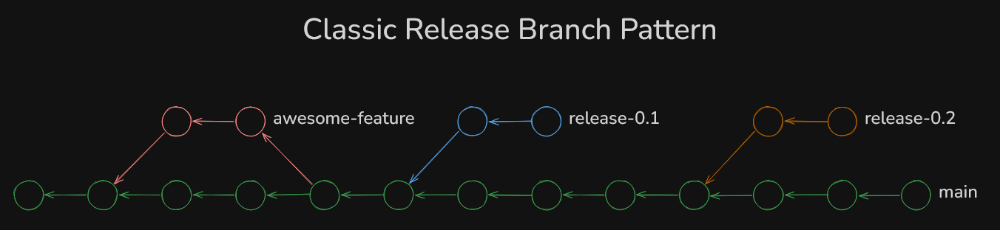
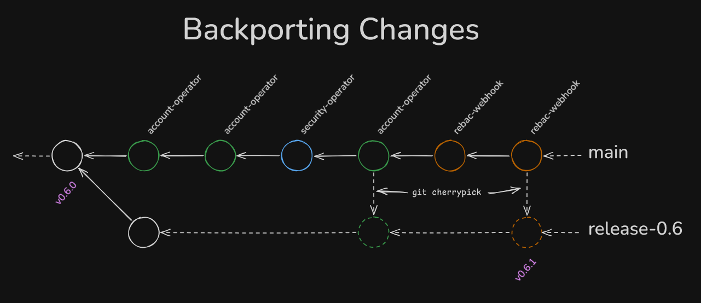
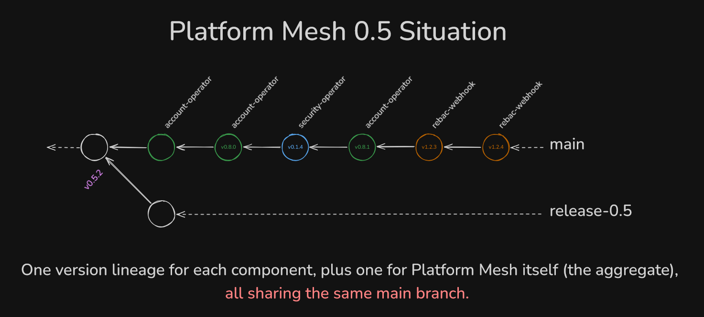
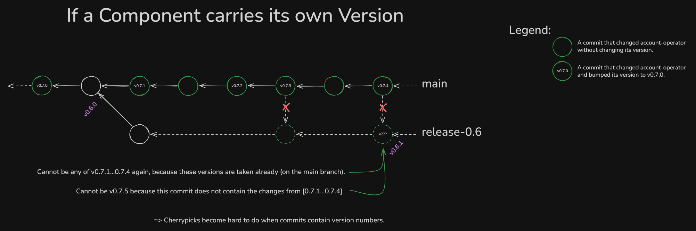
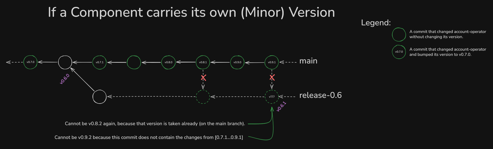
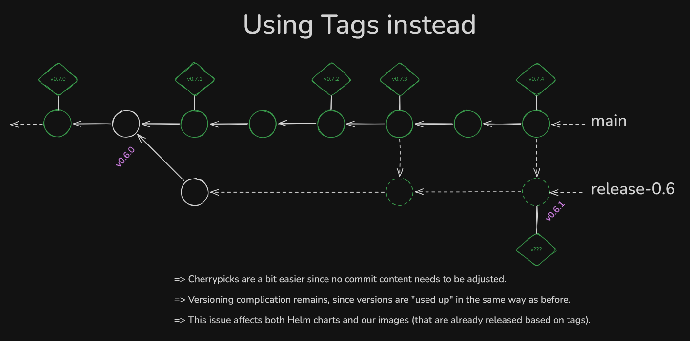
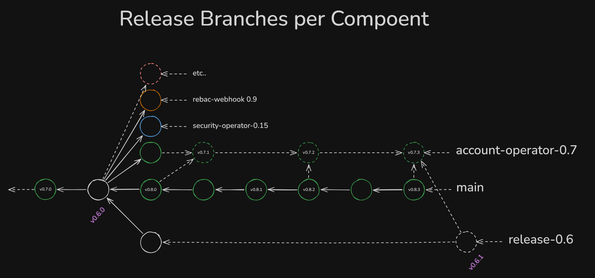

# RFC 015: Versioning Platform Mesh

| Status  | Collecting Feedback   |
|---------|------------|
| Author  | @xrstf |
| Created | 2026-10-22 |
| Updated | 2026-10-27 |

## Overview

This RFC proposes a new system to version and release Platform Mesh. It's a follow-up to [RFC 013: Repository Consolidation](./013-repo-consolidation.md), which made us merge a lot of repositories into one, but not really address their versioning schemes at all. With current efforts to further simplify the release process and take the further steps outlines in RFC 013, especially the "charts live next to the code they deploy", we would merge Helm charts into the Platform Mesh monorepo, further worsening the situation with all the different versions.

To enable further improvements, this RFC therefore proposes to take a step back and re-evaluate the versioning scheme for the new monorepo world we find ourselves in.

## Background

In ye olden days, Platform Mesh consisted of a large number of components, each homed in their own git repository, like the account-operator, security-operator, rebac-authz-webhook etc. To make a new Platform Mesh release, we would collect the most recent release of each component at the time of making the PM release.

Now after RFC 013 (Repo Consolidation) has been half-completed, most of these standalone repositories have been merged into a single monorepo, including all their existing versions. So for example account-operator v1.2.3 would have become the new git tag `account-operator/v1.2.3` in the monorepo.

Having all those different components share a single repository, but keep their own versioning, introduces a lot of complexity and difficulty for handling releases.

### Release Branch Model

This graph shows a very simple git graph, representing a repository that makes use of classic release branches. This is the same concept that most other open source projects follow, where around the time a new minor release is made, a branch is created to receive further fixes and improvements.

In such a model, new changes are generally made only on the `main` branch (exceptions exist, but the general flow should always be "commit to main, _then_ backport into the relevant release branches").

The goal of this RFC is to get us to this exact shape, where improvements and fixes can easily be backported and quickly released to consumers. For Platform Mesh, it could look like this:

In the graph above, we can see that after Platform Mesh v0.6.0 was released, a release branch was created. Later, multiple changes and new features and improvements for various components land on the `main` branch, from where they are cherrypicked into the release branch. Notably, this cherrypick is mostly automatable (Prow for example has a `/cherrypick` command to automatically create PRs) since _no content of the cherrypicked commit has to be adjusted_ (minus potential conflicts).

However, getting us to this structure has some obstacles to overcome.

### Intermittent Releases

Since we merged all those component repositories into one, we also merged all versioning information into a single repository. For example the account-operator's `v0.8.1` tag became `account-operator/v0.8.1` in the monorepo.

We can see that after Platform Mesh 0.5.2 was shipped, more changes happened on the `main` branch. Some of those changes even bump a component's version (like the 2nd commit after v0.5.2, where the account-operator was bumped to v0.8.0 (meaning the `v0.8.0` inside the circle stands for the Git tag `account-operator/v0.8.0`)). Not all changes increase the version though.

It doesn't matter here whether the version is written into a `Chart.yaml` or applied via Git tag or even both. The problem is the _linear_ situation.

Let's look closer and focus only on a single component. All other commits that change other components are simply ignored in the following graph:

Here the problem hopefully becomes a bit clearer: The commits on the main branch already "consume" version numbers, since we version each component independently. Now, after a few days and a few changes, we identified two commits to backport since we intent to ship them to consumers. At this point we run into 2 separate issues:

1. For Helm charts, the chart version is usually kept inside the `Chart.yaml`. This means that when doing a `git cherrypick`, that version is also copied over to the destination. Suddenly there are two commits (the original and the cherrypick) that claim to be the same Helm chart version. This clearly cannot be and would mean that everyone who does a cherrypick needs to manually edit the picked commit and assign a new version. Not only that, the person/agent who does it also first has to figure out which version is even correct to assign.

   This can be solved by not versioning the charts individually anymore. Then the `Chart.yaml` does not contain real versions anymore and can
   be blindly cherrypicked.

2. Even if no Helm charts are involved here and so no version is written down in the codebase, whenever a cherrypick happens, we need to determine the correct version to assign to the cherrypick. This is because a Platform Mesh release is an aggregate over the component versions, so to make sure a change is included in a Platform Mesh release, it itself needs to be released first, on its own. So the cherrypick _must_ eventually get a version assigned. The question just is: Which version?

This problem is not solved by jumping to new minor versions, as shown in the following example:

The same problems arise again.

Likewise, using tags does not resolve this problem. It certainly makes it less harsh, since cherrypicks can be automated more, but the problem of figuring out which versions to change to what remains:

### Per-Component Release Branching

The "solution" to this problem is apparent: release branches. Just a lot more of them. A working model could look like this, where every single component gets its own release branches:

This way, changes from the `main` branch can cleanly be separated out. You can see that the first change after version 0.6.0 was released would immediately bump the account-operator (on `main`) to 0.8.0. This is because the 0.7 lineage is now "owned" by the release branch `account-operator-0.7`. In effect, every component would need to make a minor version jump whenever a new Platform Mesh minor version is released (since at that point in time, we "freeze" the components' minor versions and open release branches).

Do note that still, during a cherrypick, the author/agent would have to adjust the contained version (in the `Chart.yaml` from 0.8.0 to 0.7.1) by hand. This requires them to know what the most recent patch release on 0.7.x is. As before, this requirement to change the `Chart.yaml` goes away if we decided not to have versions in the `Chart.yaml`, _but_ the manual process of figuring out what version to assign remains, even if Git tags are used.

When a new Platform Mesh release is then to be made, _all_ component release branches are merged back into Platform Mesh's release branch (i.e. `account-operator-0.7` is merged into `release-0.6`, then `security-operator-0.15` is merged into `release-0.6` etc.).

### Why version something in the first place?

At this point, we should step back and ask ourselves a question: In this example that we've already seen:

When we committed what would become account-operator v0.7.1, someone decided that this commit would be tagged with a version. For what reason though?

Clearly: We tag something so an artifact gets built and someone else out there can consume it if they choose to do so.

So by tagging we acknowledge that something is "blessed", "good to be used". But how is it now going to be used?

Look at Keith, who installed Platform Mesh today. He sees that version 0.5.2 is the latest, so he installs it, but then he notices that there is already account-operator 0.7.1 (his Platform Mesh 0.5.2 still has account-operator 0.7.0). So now Keith is wondering "Can I use 0.7.1? Is it compatible? Surely, right?"

This leads to even more uncertainty:

* Can someone use it? @brsmnv already brought up the topic of compatibility matrixes: If we randomly ship random components, how will anyone figure out which of these are even applicable to them? _Especially_ since Platform Mesh 0.5 ships with components in versions 0.7, 0.59, 1.5.2, etc. -- all over the place.

* If we decided to ship account-operator 0.7.1, why did we not actually release it? There is no changelog, no release notes, nothing. Just a tag and a hardy "Yolo, have fun with it!" from us.

* If we decided that a commit is generally useful, stable and consumable by admins, why would we not simply ship it as a new Platform Mesh release? Shipping it as a new release has all the benefits: A changelog, a nice GitHub release, visibility, all the good stuff.

Just randomly tagging components will build artifacts. But ... then nobody can really make use of them.

### Summary

We can clearly see that the current situation we maneuvered ourselves into is not working anymore. We are as of now incapable of making patch releases for older Platform Mesh releases and the approach of versioning each component/chart independently is causing a lot of churn and complexity.

## Current Versions

Since Platform Mesh already exists and has been released a couple of times, to harmonize all versions we should settle on the next "free" major or minor version. As of October 20th, we have shipped:

| Component | Latest git tag | Chart version | Chart appVersion |
|---|---|---|---|
| account-operator | account-operator/v0.15.5 | 0.23.0 | v0.15.5 |
| apis | apis/v0.1.0 | – | – |
| backup-operator | backup-operator/v0.1.0 | – | – |
| common | – | 0.16.0 | – |
| example-httpbin-operator | – | 0.10.1 | v0.6.3 |
| extension-manager-operator | extension-manager-operator/v0.10.0 | 0.45.0 | v0.10.0 |
| extension-manager-operator-crds | – | 0.5.0 | 0.0.0 |
| gateway-api-crds | – | 1.5.1 | 0.0.0 |
| golang-commons | golang-commons/v0.20.0 | – | – |
| iam-service | iam-service/v0.19.0 | 0.23.0 | v0.19.0 |
| iam-ui | – | 0.12.4 | v0.12.20 |
| infra | – | 0.45.0 | 0.0.0 |
| kcp-access-vw | – | 0.1.1 | 0.1.1 |
| kcp-mcp-vw | – | 0.1.1 | 0.1.1 |
| kcp-migration-operator | kcp-migration-operator/v0.3.0 | – | – |
| keycloak-operator | – | 0.11.0 | 0.0.0 |
| kro-composition-operator | kro-composition-operator/v0.3.0 | 0.5.1 | v0.3.0 |
| kubernetes-graphql-gateway | kubernetes-graphql-gateway/v1.20.0 | 0.54.0 | v1.20.0 |
| kubernetes-graphql-gateway-crds | – | 0.4.0 | 0.0.0 |
| marketplace-ui | – | 0.13.0 | v0.14.0 |
| observability | – | 0.9.0 | 0.0.0 |
| platform-mesh-operator | platform-mesh-operator/v0.89.1 | 0.61.0 | v0.89.1 |
| platform-mesh-operator-crds | – | 0.13.0 | 0.0.0 |
| platform-mesh-prerequisites | – | 0.2.2 | 0.1.0 |
| portal | – | 0.21.16 | v0.27.17 |
| rebac-authz-webhook | rebac-authz-webhook/v0.12.0 (newer pre-release: v0.12.1-test.3) | 0.25.0 | v0.12.0 |
| resource-broker | resource-broker/v0.1.0 | – | – |
| search-operator | search-operator/v0.7.0 | – | – |
| search-service | search-service/v0.1.0 | – | – |
| security-operator | security-operator/v0.36.0 | 0.40.0 | v0.36.0 |
| subroutines | subroutines/v0.7.0 | – | – |
| tenancy-operator | tenancy-operator/v0.0.2 | – | – |
| terminal-controller-manager | terminal-controller-manager/v0.7.0 | 0.8.1 | v0.7.0 |
| virtual-workspaces | virtual-workspaces/v0.17.0 | 0.14.0 | v0.17.0 |
| *(old helm-charts repo tag)* | helm-charts/0.5.2 | – | – |

The highest version number of Platform Mesh-native components is used by `kubernetes-graphql-gateway` at `1.20.0` and the `platform-mesh-operator` at `0.89.1`. Finding a new starting point so that all releases going forward will not eventually reach around and potentially re-define existing versions is tough, so this RFC proposes [CalVer](#calver) as an alternative further down.

## Release Branching Timeline

There is no hard requirement for where a release branch has to be branched off the `main` branch: some projects do it on the first alpha, some only on the final `X.Y.0` release. The idea behind release branches is unaffected by this, the difference is primarily workflow based:

* Branching the release branch off early means that the `main` branch is immediately ready to receive breaking changes again. In effect, there would be no prolonged code freeze on the `main` branch, where only bugfixes must be merged. But the downside is that every bugfix that is meant to be shipped has to be cherrypicked into the new release branch already.
* Branching off late, for example on a release candidate or even the final release, allows for bugfixes to land easily, but requires everyone to hold off with breaking changes for a while.

It's a trade-off that can be re-evaluated on a daily basis, if needed.

Technically, release branches must also not be created a priori, but can be created later on-demand (i.e. on the first occasion where something should be backported, i.e. cherrypicked). However, creating such branches is often restricted to people with elevated permissions, so it can be beneficial to just create the release branch on the day of the final release (the `X.Y.0`) as part of the release procedure. Then everyone can easily target cherrypicks to that branch without having to ask in chats first for someone to create the branch.

## CalVer?

[CalVer Reference](https://calver.org/)

There is an argument to be made that Platform Mesh's compatibility layer is not its version, but the version of all the Kubernetes API it handles. Any version that can handle `v1alpha2` of something is compatible to any other version that does. That is the true interface to Platform Mesh and so should be the focus of our compatibility.

Given this, a semantic version for Platform Mesh makes not much sense. We have also seen above that the "used-up" range for semvers is all the way at `1.20.0` already, which would force us to use at least `1.21` for the next Platform Mesh release, making quite a significant, yet meaningless jump to a mostly arbitrary new version.

One could argue that a calendar-based version, like `v26.10.0` (October 2026, patch version 0) conveys more useful information to the admin. However since the tooling used to install Platform Mesh (flux, ArgoCD, Helm) are geared towards semver, we would have to wrap the date in a semver-like string, like given above. A version like `RELEASE.2026-10` would not work reliably for us.

For these reasons this RFC proposes using CalVer in the future to version Platform Mesh. The proposed versioning scheme is what projects like Ubuntu are already using: `vYY.MM[.Patch]`, for example `v26.10.0` for the October 2026 release. For patch releases the final number is incremented (like in semver), for example in late October or November a `v26.10.1` would follow. Versions of this schema follow the semver convention nicely.

This scheme leaves enough room for monthly releases without being to overly verbose and include the day of the month (which would enable more frequent "minor" releases). Judging from the current velocity it's unlikely that Platform Mesh will ever want to do feature releases (what in semver would be called "minor releases") more than once per month though.

## Proposal

Having discussed all of this, there can be only one solution: Version Platform Mesh as one coherent application. One version number to rule them all. In detail this would mean:

* `YY` stands for the last two digits of the current year, `MM` for the zero-padded month and `Patch` is an incrementing number for each subsequent release, like is done in semver.
* Platform Mesh releases are made by tagging a commit with `vYY.MM.Patch`.
* Each `YY.MM.0` release gets a new `release-YY.MM` branch created.
* Patch releases are tagged on their parent release branch (i.e. `vYY.MM.3` is on `release-YY.MM`).
* Individual components are not tagged or shipped on their own anymore. This means Helm chart versions are now identical to the component they wrap (i.e. account-operator-chart == account-operator, and inside the `Chart.yaml` the `version` and `appVersion` fields are identical). Charts that wrap upstream components have their `appVersion` point to the upstream version and `version` is the new unified Platform Mesh version.
* Inside the repository, each chart has `version: 0.0.0` and gets the real version injected during the release workflow. End-users are not meant to install the charts from the Git repository anyway, and having "no" version further discourages that.
* To make a change available in older Platform Mesh releases, they just need to be git-cherrypicked.
